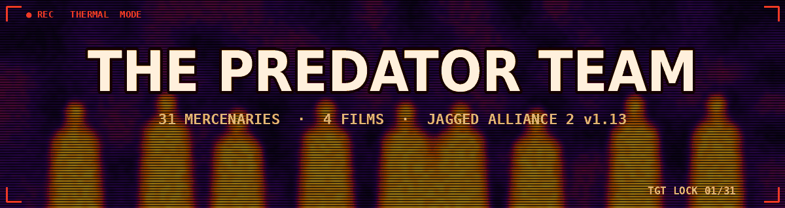

  

# The Predator Team - mercenaries

31 operators from the four films. Stats are on the JA2 1.13 scale (0-100), the day rate is in dollars. Traits use the 1.13 new trait system.

## By film

- **Predator 1987**: Dutch, Mac, Blain, Billy, Poncho, Hawkins, Dillon
- **Predator 1990**: Harrigan, Leona, Danny, Lambert, Keyes, Willie, Heinemann
- **Predators 2010**: Royce, Isabelle, Edwin, Stans, Noland, Cuchillo, Nikolai, Hanzo, Mombasa
- **The Predator 2018**: Quinn, Nebraska, Baxley, Coyle, Lynch, Nettles, Casey, Traeger

## Predator 1987

| ID | Name | Role | Lvl | Day rate | Traits | Standard weapon |
|:---:|:---:|:---:|:---:|:---:|:---:|:---:|
| 0 | **Dutch (Alan "Dutch" Schaefer)** | Major. Team leader, rescue specialist | 9 | $8,500 | Squadleader, Stealthy, Survival | Colt M16A1 |
| 1 | **Mac (Mac Eliot)** | Sergeant. Machine gunner, Blain's best friend | 7 | $5,000 | Auto Weapons, Melee, Night Ops | M60E3 |
| 2 | **Blain (Blain Cooper)** | Sergeant. Heavy weapons, minigun | 7 | $4,800 | Heavy Weapons, Auto Weapons, Bodybuilding | Rheinmetall MG3 |
| 3 | **Billy (Billy Sole)** | Scout and tracker | 8 | $5,800 | Ranger, Scouting, Melee | Colt M16A1 |
| 4 | **Poncho (Jorge "Poncho" Ramirez)** | Grenadier, interpreter | 7 | $4,600 | Heavy Weapons, Demolitions, Throwing | Milkor MGL-140 Grenade Launcher |
| 5 | **Hawkins (Rick Hawkins)** | Radio operator, technician | 6 | $3,500 | Technician, Radio Operator, Scouting | Colt M16A1 |
| 6 | **Dillon (Al Dillon)** | CIA officer, old friend of Dutch | 7 | $5,500 | Auto Weapons, Covert Ops, Athletics | HK MP5A4 |

## Predator 1990

| ID | Name | Role | Lvl | Day rate | Traits | Standard weapon |
|:---:|:---:|:---:|:---:|:---:|:---:|:---:|
| 7 | **Harrigan (Mike Harrigan)** | LAPD lieutenant. Stubborn, fearless leader | 8 | $7,000 | Squadleader, Gunslinger, Athletics | SPAS-12 |
| 8 | **Leona (Leona Cantrell)** | LAPD detective. Tough, fast with a SMG | 5 | $3,200 | Auto Weapons, Gunslinger, Athletics | HK MP5KA4 |
| 9 | **Danny (Danny Archuleta)** | LAPD detective. Harrigan's oldest friend | 4 | $2,400 | Gunslinger, Scouting, Athletics | Beretta 92F |
| 10 | **Lambert (Jerry Lambert)** | LAPD detective. Cocky newcomer with a shotgun | 5 | $2,800 | Ranger, Bodybuilding, Melee | Remington M870 |
| 11 | **Keyes (Peter Keyes)** | Federal agent. Head of a special task force | 6 | $5,000 | Squadleader, Technician, Night Ops | HK MP5KA4 |
| 12 | **Willie (King Willie)** | Gang boss and mystic. Sees what others miss | 4 | $2,500 | Squadleader, Melee, Covert Ops | Barracuda |
| 13 | **Heinemann (Phil Heinemann)** | LAPD deputy chief. Commander and organiser | 4 | $2,600 | Squadleader, Radio Operator, Gunslinger | Colt M1911A1 |

## Predators 2010

| ID | Name | Role | Lvl | Day rate | Traits | Standard weapon |
|:---:|:---:|:---:|:---:|:---:|:---:|:---:|
| 14 | **Royce** | Mercenary leader, ex-special forces | 8 | $7,000 | Auto Weapons, Survival, Stealthy | USAS-12 |
| 15 | **Isabelle** | IDF sniper | 7 | $6,000 | Sniper (expert), Stealthy | Dragunov SVD |
| 16 | **Edwin** | Doctor | 4 | $2,800 | Doctor (expert) | Beretta 92F |
| 17 | **Stans (Walter Stans)** | Death row convict | 4 | $1,800 | Martial Arts, Melee, Bodybuilding | Beretta 93R |
| 18 | **Noland (Ronald Noland)** | Survivor of earlier hunts | 7 | $4,500 | Ranger, Survival, Stealthy | Ingram M10 |
| 19 | **Cuchillo** | Cartel enforcer | 5 | $2,800 | Auto Weapons, Melee, Throwing | Uzi |
| 20 | **Nikolai** | Spetsnaz soldier, heavy weapons | 7 | $5,200 | Heavy Weapons, Auto Weapons, Bodybuilding | PKM |
| 21 | **Hanzo** | Yakuza enforcer, swordsman | 7 | $4,800 | Martial Arts, Melee, Stealthy | Katana |
| 22 | **Mombasa** | Death squad officer | 7 | $5,000 | Auto Weapons, Athletics, Night Ops | AK-47 |

## The Predator 2018

| ID | Name | Role | Lvl | Day rate | Traits | Standard weapon |
|:---:|:---:|:---:|:---:|:---:|:---:|:---:|
| 23 | **Quinn (Quinn McKenna)** | Army Ranger sniper. Leader of the "Loonies" | 8 | $7,500 | Sniper, Stealthy, Survival | M40A1 |
| 24 | **Nebraska (Nebraska Williams)** | Veteran soldier. Quinn's right hand | 7 | $5,200 | Auto Weapons, Melee, Athletics | HK 53A3 |
| 25 | **Baxley** | Ex-soldier. Rifleman, nervous tic, foul mouth | 6 | $3,800 | Auto Weapons, Throwing, Bodybuilding | Ruger Mini-14 |
| 26 | **Coyle** | Ex-soldier. Squad joker, Baxley's best friend | 6 | $3,600 | Auto Weapons, Throwing, Athletics | HK MP5KA4 |
| 27 | **Lynch** | Ex-soldier. Card sharp and demolitions man | 6 | $3,800 | Technician, Demolitions, Ambidextrous | Remington M870 |
| 28 | **Nettles** | Former military helicopter pilot | 5 | $3,200 | Technician, Radio Operator, Scouting | SPAS-12 |
| 29 | **Casey (Casey Bracket)** | Evolutionary biologist. Science advisor | 4 | $3,000 | Doctor, Teaching, Survival | .38 Special |
| 30 | **Traeger (Will Traeger)** | Government agent. Head of a secret program | 6 | $5,500 | Squadleader, Covert Ops, Ambidextrous | Glock 17 |

## Stats

| ID | Name | Film | HLT | AGI | DEX | STR | WIS | LDR | MRK | MEC | EXP | MED |
|:---:|:---:|:---:|:---:|:---:|:---:|:---:|:---:|:---:|:---:|:---:|:---:|:---:|
| 0 | **Dutch** | 1987 | **95** | 85 | 85 | **95** | 88 | **95** | **90** | 55 | 75 | 45 |
| 1 | **Mac** | 1987 | **90** | 75 | 80 | **90** | 70 | 55 | **90** | 40 | 50 | 30 |
| 2 | **Blain** | 1987 | **96** | 70 | 70 | **98** | 60 | 45 | 85 | 40 | 50 | 20 |
| 3 | **Billy** | 1987 | **90** | **92** | 85 | 85 | **90** | 45 | 85 | 35 | 40 | 45 |
| 4 | **Poncho** | 1987 | 88 | 78 | 80 | 82 | 72 | 50 | 82 | 50 | 85 | 35 |
| 5 | **Hawkins** | 1987 | 78 | 75 | 82 | 68 | 80 | 40 | 78 | 75 | 45 | 45 |
| 6 | **Dillon** | 1987 | 88 | 78 | 80 | 85 | 85 | 80 | 85 | 45 | 55 | 30 |
| 7 | **Harrigan** | 1990 | **92** | 82 | 84 | 82 | 85 | 85 | 88 | 50 | 55 | 40 |
| 8 | **Leona** | 1990 | 78 | 80 | 78 | 60 | 75 | 55 | 75 | 35 | 30 | 40 |
| 9 | **Danny** | 1990 | 72 | 80 | 80 | 62 | 70 | 45 | 76 | 40 | 30 | 35 |
| 10 | **Lambert** | 1990 | 82 | 72 | 70 | 80 | 55 | 40 | 74 | 35 | 30 | 25 |
| 11 | **Keyes** | 1990 | 76 | 70 | 76 | 68 | **92** | 80 | 76 | 75 | 50 | 50 |
| 12 | **Willie** | 1990 | 65 | 55 | 65 | 55 | **90** | 80 | 55 | 30 | 35 | 50 |
| 13 | **Heinemann** | 1990 | 72 | 58 | 68 | 66 | 76 | 78 | 70 | 30 | 30 | 30 |
| 14 | **Royce** | 2010 | **90** | 86 | 84 | 82 | **92** | 82 | 88 | 50 | 60 | 45 |
| 15 | **Isabelle** | 2010 | 82 | 85 | 88 | 62 | 86 | 60 | **96** | 40 | 40 | 45 |
| 16 | **Edwin** | 2010 | 60 | 65 | 85 | 50 | **90** | 30 | 45 | 40 | 25 | **92** |
| 17 | **Stans** | 2010 | 85 | 75 | 70 | 85 | 40 | 20 | 65 | 30 | 30 | 10 |
| 18 | **Noland** | 2010 | 75 | 70 | 78 | 70 | **92** | 45 | 82 | 70 | 65 | 50 |
| 19 | **Cuchillo** | 2010 | 82 | 82 | 84 | 76 | 60 | 30 | 78 | 30 | 35 | 15 |
| 20 | **Nikolai** | 2010 | **96** | 66 | 72 | **96** | 65 | 55 | 86 | 50 | 70 | 25 |
| 21 | **Hanzo** | 2010 | 86 | **95** | **92** | 76 | 85 | 40 | 70 | 30 | 25 | 30 |
| 22 | **Mombasa** | 2010 | **90** | 78 | 80 | 88 | 72 | 70 | 86 | 40 | 55 | 25 |
| 23 | **Quinn** | 2018 | **90** | 86 | 88 | 82 | **90** | 80 | **97** | 40 | 55 | 45 |
| 24 | **Nebraska** | 2018 | **92** | 82 | 80 | 86 | 75 | 55 | 86 | 40 | 45 | 35 |
| 25 | **Baxley** | 2018 | 88 | 72 | 76 | 84 | 62 | 35 | 84 | 40 | 50 | 20 |
| 26 | **Coyle** | 2018 | 82 | 80 | 82 | 72 | 70 | 40 | 80 | 40 | 40 | 30 |
| 27 | **Lynch** | 2018 | 78 | 82 | 88 | 66 | 78 | 40 | 76 | 75 | 80 | 35 |
| 28 | **Nettles** | 2018 | 84 | 74 | 78 | 80 | 66 | 35 | 78 | 70 | 40 | 25 |
| 29 | **Casey** | 2018 | 70 | 76 | 78 | 55 | **95** | 50 | 65 | 55 | 30 | 75 |
| 30 | **Traeger** | 2018 | 78 | 70 | 78 | 68 | **90** | 85 | 76 | 45 | 40 | 35 |

Values of 90+ are in bold.

HLT health, AGI agility, DEX dexterity, STR strength, WIS wisdom, LDR leadership, MRK marksmanship, MEC mechanical, EXP explosives, MED medical.
